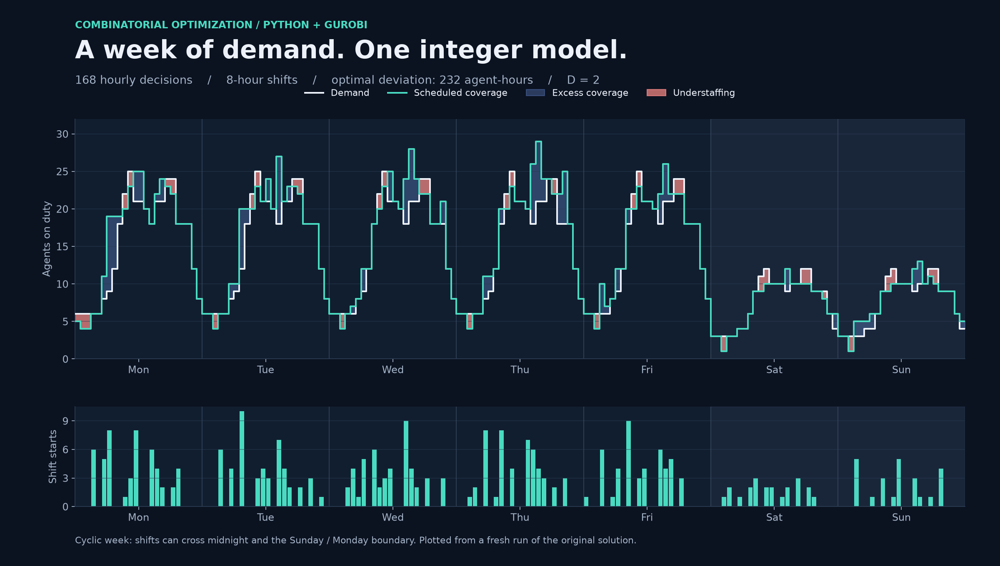
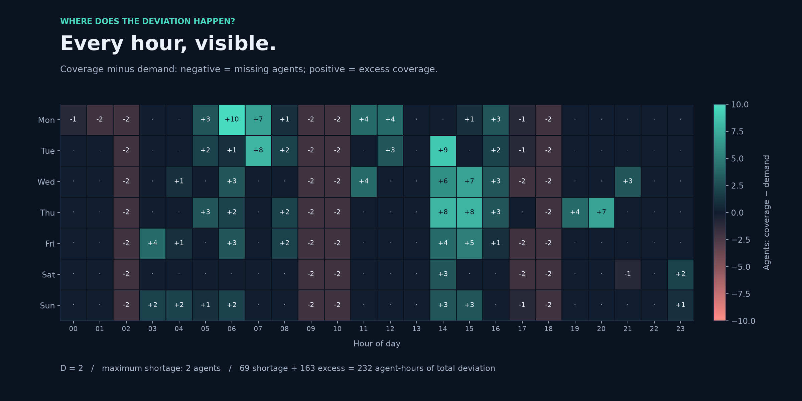
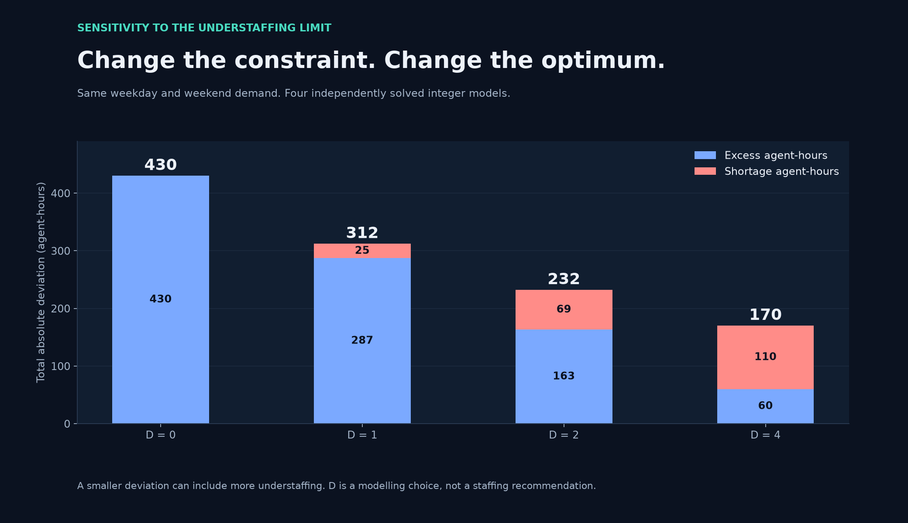

# Kombinatorická optimalizace — plánování směn

**Od hodinové poptávky call centra k cyklickému týdennímu rozvrhu pomocí celočíselného lineárního programování.**

[Obrazový průchod](docs/demo.md) · [Matematický model](docs/model.md) · [Ověření výsledků](docs/verification.md) · [English](README.md)

## Co úloha řeší

Call centrum potřebuje v každou hodinu jiný počet pracovníků. Směna trvá osm hodin a může začít v libovolnou celou hodinu. Pracovní dny a víkend mají odlišnou poptávku a celý týdenní rozvrh se opakuje.

Moje řešení školní úlohy sestavuje **celočíselný lineární model v Pythonu pomocí Gurobi**. Pro každou ze **168 hodin týdne** určuje počet začínajících směn. Minimalizuje součet absolutních rozdílů mezi požadovaným a přítomným počtem pracovníků. Samostatné omezení **D** určuje, kolik pracovníků smí nejvýše chybět v jedné hodině.

Jde o práci z kombinatorické optimalizace na **FEL ČVUT**. Zadání a příkladová data pocházejí z předmětu; showcase představuje řešení uložené v mém repozitáři a nově vytvořené grafy jeho výstupů.

## Ověřený výsledek

| Hlavní příklad | Výsledek |
| --- | --- |
| Horizont / délka směny | 168 hodin / 8 hodin |
| Nejvyšší povolený podstav | 2 pracovníci v jedné hodině |
| Optimální celková absolutní odchylka | **232 člověkohodin** |
| Rozklad odchylky | 69 chybějících + 163 přebytečných člověkohodin |
| Cílová hodnota / mez solveru | 232 / 232 |

Původní program jsem pro tuto prezentaci znovu spustil **17. listopadu 2026**. Výsledek odpovídá hodnotě **232** uvedené v zadání. Osm výpočtů zahrnuje čtyři uložené testovací vstupy a čtyři různá nastavení D. U všech se z výstupního rozvrhu samostatně přepočítalo pokrytí, dodržení limitu a hodnota cíle.

## Co projekt ukazuje

- Převod praktické úlohy na celočíselné proměnné, cíl a lineární omezení.
- Cyklické indexování směn přes půlnoc i hranici mezi nedělí a pondělím.
- Linearizaci absolutní hodnoty pomocnými proměnnými.
- Vliv změny omezení na optimum a interpretaci výsledku.
- Kontrolu výsledných 168 rozhodnutí přepočtem ze zapsaného výstupu.

## Jak výsledek mění limit podstavu

| Limit D | Optimální odchylka v člověkohodinách |
| --- | ---: |
| 0 | 430 |
| 1 | 312 |
| 2 | **232** |
| 4 | 170 |

Vyšší povolený podstav může snížit celkovou absolutní odchylku. Menší hodnota cíle ale může zároveň obsahovat více nepokrytých hodin práce. Model optimalizuje shodu pokrytí s poptávkou; neřeší mzdy ani rozpis konkrétních zaměstnanců.

## Podrobnosti a data

- [Obrazový průchod](docs/demo.md), [matematický model](docs/model.md) a [ověření](docs/verification.md) jsou anglicky.
- [Hodinová data CSV](demo/hourly-schedule.csv), [vstup](demo/input.txt), [výstup](demo/solution.txt) a [záznam ověření](demo/verification.json).
- [Původní řešení](https://github.com/Dolik64/KO_cvut/blob/bf26f99a31e2519d7921f9ec5bc57c29cb463e5a/python/HW1/main.py) v repozitáři [KO_cvut](https://github.com/Dolik64/KO_cvut).

**Python · Gurobi · Celočíselné lineární programování · Plánování směn · Vizualizace dat**

Tento repozitář obsahuje prezentaci, grafy a výsledná data. Zdrojový program zůstává v odkazovaném školním repozitáři. Grafy byly pro showcase vytvořeny z vypočtených výsledků.
