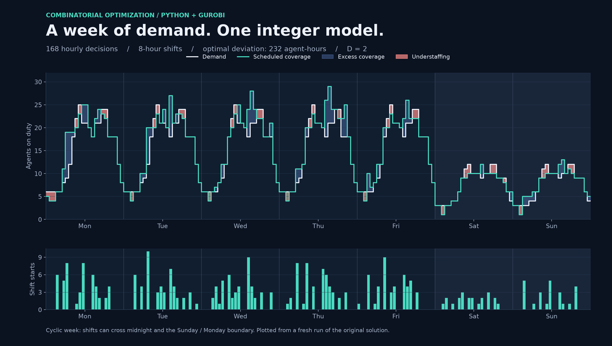
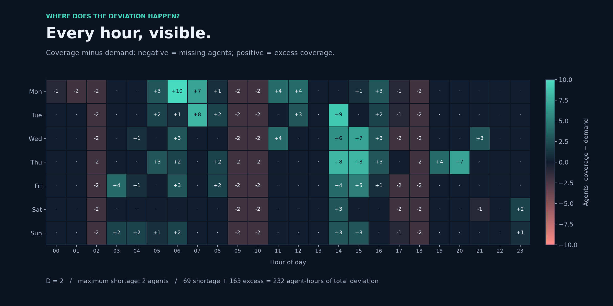
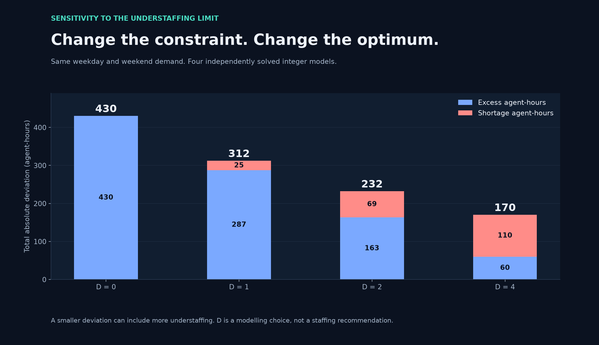

# Combinatorial Optimization — Shift Scheduling

**Turning hourly call-center demand into a cyclic weekly schedule with integer linear programming.**

[Visual walkthrough](docs/demo.md) · [Mathematical model](docs/model.md) · [Verification](docs/verification.md) · [Česky](README.cs.md)

## The problem

A call center has a different staffing requirement for each hour. Each shift lasts eight hours and can begin at any full hour. Weekdays and weekends have separate demand profiles, and the weekly schedule repeats.

My coursework solution builds an **integer linear program in Python with Gurobi**. It chooses how many shifts start in each of the week's **168 hours**, minimising the total absolute difference between demand and scheduled coverage. A separate limit, **D**, caps the number of missing agents in any hour.

This was developed for combinatorial-optimization coursework at **CTU FEL**. The problem and example data come from the course; this showcase presents the solution stored in my repository and new visualisations of its output.

## A verified result

| Main example | Result |
| --- | --- |
| Planning horizon / shift duration | 168 hours / 8 hours |
| Maximum permitted hourly shortage | 2 agents |
| Optimal total absolute deviation | **232 agent-hours** |
| Decomposition | 69 shortage + 163 excess agent-hours |
| Solver's final objective / bound | 232 / 232 |

The original program was run again on **17 November 2026**. Its result matches the **232** stated in the assignment. Eight runs cover four stored test inputs and four settings of D; all passed independent checks of the written schedule and objective.

## What this project demonstrates

- **Modelling decisions:** nonnegative integer variables represent shift starts rather than individual employees.
- **Cyclic time:** modulo indexing correctly includes shifts that cross midnight or the Sunday–Monday boundary.
- **Absolute-value linearisation:** auxiliary variables turn the deviation objective into linear inequalities.
- **Constraint analysis:** changing the shortage limit shows how service tolerance changes the optimum.
- **Result validation:** coverage, shortage and objective are recomputed from all 168 output decisions.

## Change the shortage limit

| Hourly shortage limit D | Optimal deviation (agent-hours) |
| --- | ---: |
| 0 | 430 |
| 1 | 312 |
| 2 | **232** |
| 4 | 170 |

Allowing more shortage can reduce the absolute-deviation objective. The chart also shows why that number needs context: a lower objective may contain more understaffing. This model optimises coverage fit; it does not minimise payroll or create named employees' rosters.

## Explore

- [Visual walkthrough](docs/demo.md): read the schedule, trace a boundary-crossing shift and compare the four optima.
- [Mathematical model](docs/model.md): variables, objective and constraints.
- [Verification and provenance](docs/verification.md): source snapshot, fresh runs and reproduction.
- [Hourly CSV](demo/hourly-schedule.csv), [example input](demo/input.txt), [solution](demo/solution.txt) and [verification data](demo/verification.json).
- [Original coursework solution](https://github.com/Dolik64/KO_cvut/blob/bf26f99a31e2519d7921f9ec5bc57c29cb463e5a/python/HW1/main.py) in my public [KO_cvut repository](https://github.com/Dolik64/KO_cvut).

**Python · Gurobi · Integer linear programming · Cyclic scheduling · Data visualisation**

This repository contains the presentation, plots and result data. The original solver source remains in the linked coursework repository. All charts were generated from computed results for this showcase.
