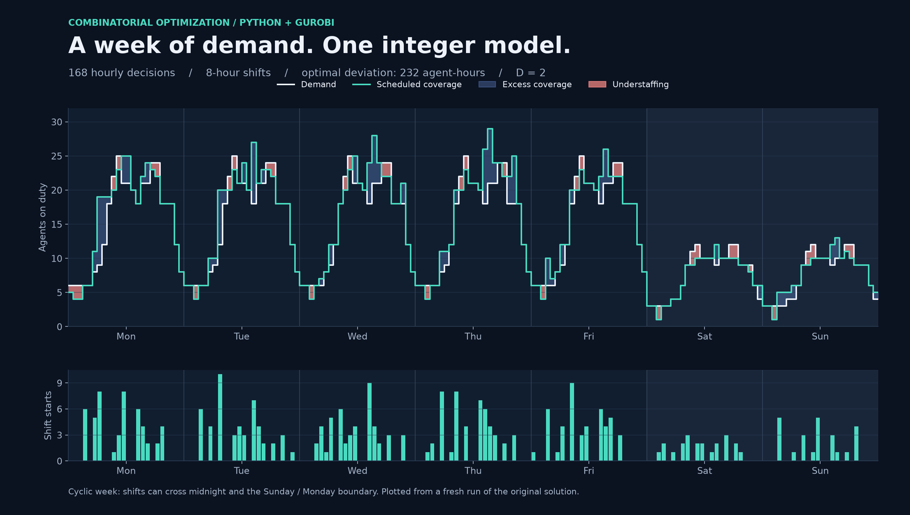
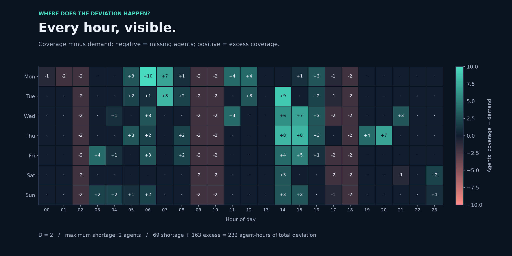
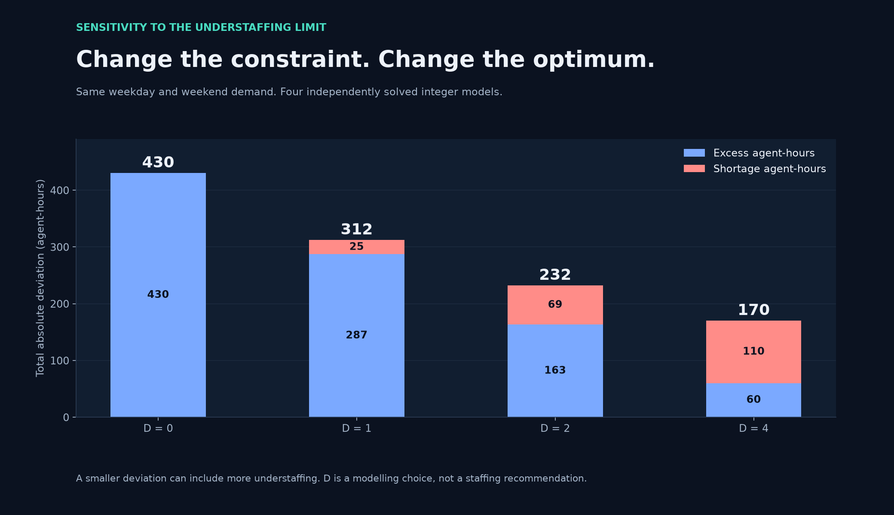

# From demand to a weekly schedule

[Project](../README.md) · [Model](model.md) · [Verification](verification.md)

## 1. Supply weekday demand, weekend demand and a shortage limit

The [example input](../demo/input.txt) contains 24 weekday values, 24 weekend values and D = 2. It is the main worked weekly example from the course assignment. Weekday demand peaks at 25 agents; weekend demand peaks at 12.

## 2. Optimise 168 shift-start decisions

The upper chart compares demand with the coverage produced by the schedule. The lower chart shows the actual decisions: how many eight-hour shifts start in each hour. Coverage is computed by adding the current hour's starts to those from the preceding seven hours.

The source uses modulo 168, so a Sunday evening shift can still contribute to Monday morning. This matters at the boundary: it is a repeating week, not a plan that begins with an empty call center.

For the plotted optimum, the output contains **287 shift starts**, representing **2296 scheduled agent-hours** against **2202 required agent-hours**. These are counts of shifts and work hours, not unique employees. Other schedules may attain the same objective.

## 3. Inspect each hour, not only the objective

Every heatmap cell is **coverage minus demand**. Negative values represent missing agents; positive values represent excess coverage. In this selected solution, no negative value is below -2, so the hourly shortage constraint is respected.

The objective is the sum of absolute cell values: **69 shortage + 163 excess = 232 agent-hours**. The [hourly CSV](../demo/hourly-schedule.csv) exposes demand, starts, coverage and error for all 168 hours.

## 4. Ask what changes when the shortage limit changes

| D | Optimal objective | Shortage agent-hours | Excess agent-hours |
| ---: | ---: | ---: | ---: |
| 0 | 430 | 0 | 430 |
| 1 | 312 | 25 | 287 |
| 2 | 232 | 69 | 163 |
| 4 | 170 | 110 | 60 |

All four runs use the same demand vectors. The optimal total falls as the constraint is relaxed. The shortage/excess split describes the particular optimal schedules returned in these runs; it is not necessarily unique. This is a sensitivity experiment, not evidence of savings at a real call center.

## 5. Check the result independently

The verifier reads the written output and rebuilds cyclic coverage directly from the 168 shift-start counts. It checks integrality, nonnegativity, the hourly shortage limit and the exact objective. The solver logs additionally report a final bound equal to the objective for every run.

See [verification](verification.md) for the complete run table and reproduction steps. The three charts are new plots of computed data; they are not screenshots of an application UI.
